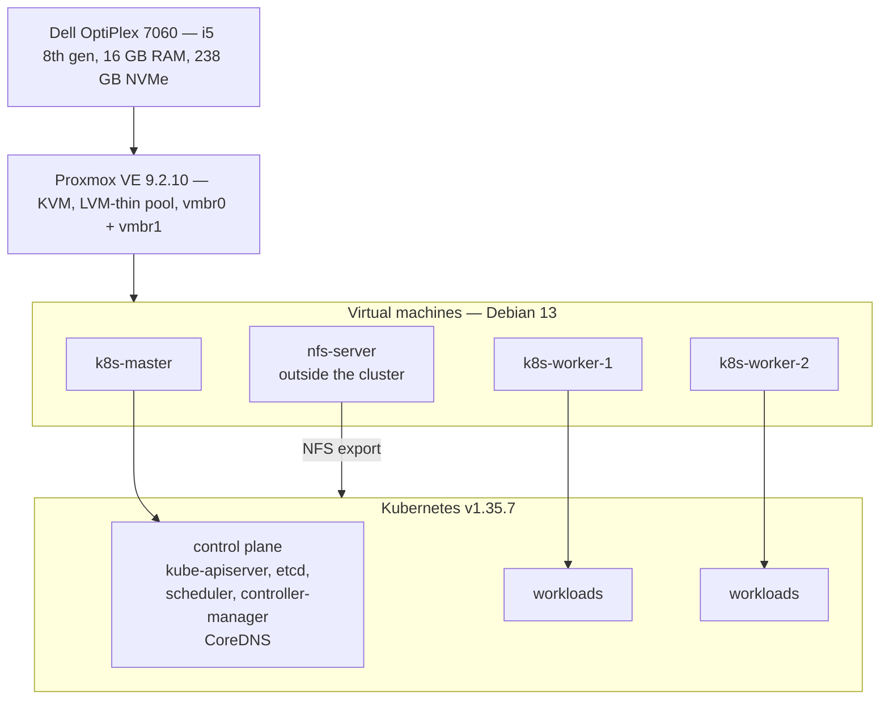
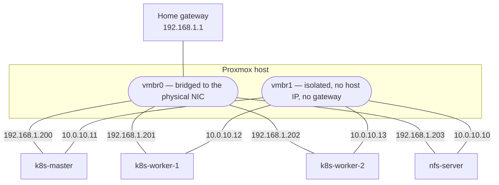
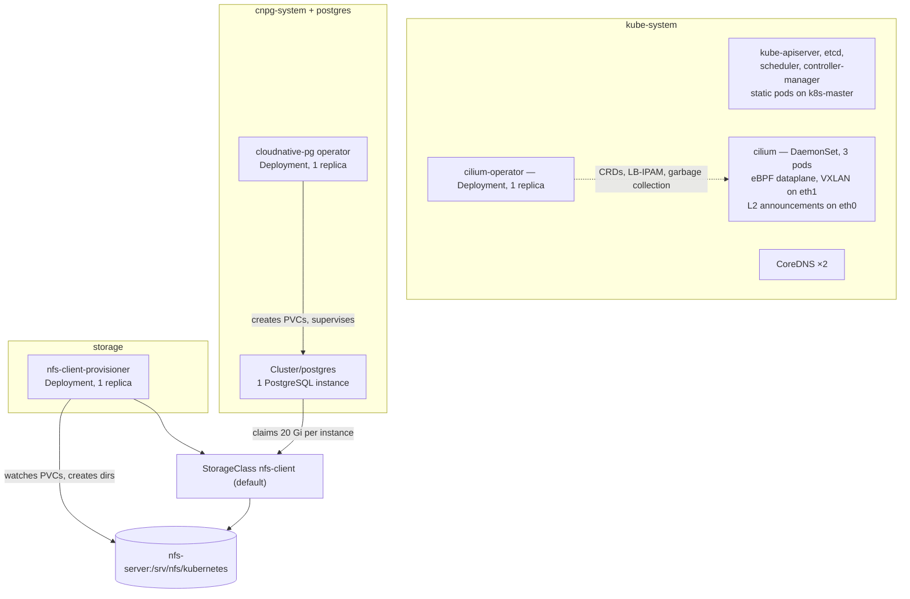

# Architecture

This document describes the system. The [decision records](decisions/) explain why
the main choices were made, and [provisioning.md](provisioning.md) describes how it
is built.

The cluster has three `Ready` nodes running Kubernetes v1.35.7. Cilium provides the
pod network and announces `LoadBalancer` addresses on the LAN. A default
`StorageClass` backed by NFS provisions volumes on demand. Prometheus and Grafana
collect and display the cluster's own metrics, and PostgreSQL runs as the first
stateful application workload, under the CloudNativePG operator.

## Layers

**Hardware.** The lab runs on one machine. Losing its SSD, motherboard, or power
supply takes down the entire lab.

**Proxmox VE.** The hypervisor runs the virtual machines under KVM and owns two
pieces of state the layers above depend on: the storage pools and the network
bridges. Storage is split between `local`, a plain directory holding the cloud
image, the cloud-init snippets and backups, and `local-lvm`, an LVM-thin pool
holding the virtual disks. *LVM-thin* means volumes are thin-provisioned: a 32 GB
disk consumes only the blocks actually written. The sum of the declared sizes may
 therefore exceed the pool, and does here. If the pool fills up, every virtual
 machine on it becomes read-only.

**Virtual machines.** Four Debian 13 machines, each with two virtual NICs.
Terraform creates the machines and assigns their identity and addresses. Ansible
configures everything inside them.

**Kubernetes.** Three of the four machines form the cluster, installed with
`kubeadm` on `containerd` 1.7.24. The fourth stays outside it and serves storage
over NFS.

## The four machines

Names, identifiers and sizing come from `terraform/main.tf`, which is the source
of truth for everything in this section.

| Name | VMID | Role | vCPU | Memory | System disk | Data disk |
|---|---|---|---|---|---|---|
| `k8s-master` | 200 | control plane | 2 | 3072 MB | 20 GB | — |
| `k8s-worker-1` | 201 | worker | 2 | 3584 MB | 32 GB | — |
| `k8s-worker-2` | 202 | worker | 2 | 3584 MB | 32 GB | — |
| `nfs-server` | 203 | storage, outside the cluster | 2 | 1024 MB | 10 GB | 40 GB |

Each machine is tagged in Proxmox with its role, taken from the same map, so the
hypervisor UI shows the same grouping the Ansible inventory does.

`k8s-master` keeps the standard `node-role.kubernetes.io/control-plane:NoSchedule`
taint, so no application workload lands on it. The workers are interchangeable, so
either one can be drained.

`nfs-server` carries a second virtual disk of 40 GB, mounted by UUID on
`/srv/nfs` and exported to the cluster network. Keeping it out of Kubernetes
decouples the data from the cluster lifecycle. The three nodes can be reset,
reinstalled, or recreated without deleting the data. Terraform marks this machine
`protection = true`, which makes
Proxmox refuse to delete it; a `terraform destroy` fails on it rather than taking
the data with it. The three Kubernetes nodes carry no such flag and are
disposable by design.

The storage machine is a single point of failure for persistent volumes. Replicating
storage across VMs on the same SSD would not provide real redundancy.

## Networks

Every machine has two interfaces, attached to two different Proxmox bridges. A
*bridge* on the hypervisor is a virtual switch: `vmbr0` is bridged onto the
physical NIC and therefore onto the house LAN, while `vmbr1` has no physical port
and no IP address on the host side, so it is a switch that exists only between
the VMs.

**`vmbr0` — LAN, `192.168.1.0/24`.** Administration traffic uses SSH, Ansible, and
`kubectl`. The default gateway, `192.168.1.1`, is configured on this interface only.

**`vmbr1` — cluster-internal, `10.0.10.0/24`.** Infrastructure traffic includes etcd,
the API server, kubelet registration, the Cilium VXLAN overlay, and NFS. It has
**no gateway and no default route**. The hypervisor itself
holds no address on this segment.

The API server advertises `10.0.10.11:6443`. The API certificate also includes the
LAN address as a SAN, so changing the endpoint later does not require a reissue.

The separation depends on the configuration as well as the wiring. See
[provisioning.md](provisioning.md#which-interface-twice) for the three settings
that enforce it.

`/etc/hosts` on every machine maps the four internal addresses to
`<name>.internal`, so the nodes can address each other by name over `vmbr1`
without a DNS server.

### Address plan

LAN, `192.168.1.0/24`:

| Address | Assignment |
|---|---|
| `192.168.1.1` | Gateway |
| `192.168.1.200` | `k8s-master` |
| `192.168.1.201` | `k8s-worker-1` |
| `192.168.1.202` | `k8s-worker-2` |
| `192.168.1.203` | `nfs-server` |
| `192.168.1.204` – `.209` | Reserved for future nodes |
| `192.168.1.210` | Grafana, pinned via `lbipam.cilium.io/ips` |
| `192.168.1.211` – `.220` | `LoadBalancer` pool — see below |

Cluster-internal, `10.0.10.0/24`:

| Address | Assignment |
|---|---|
| `10.0.10.10` | `nfs-server` |
| `10.0.10.11` | `k8s-master` |
| `10.0.10.12` | `k8s-worker-1` |
| `10.0.10.13` | `k8s-worker-2` |

Kubernetes internal ranges: pods on `10.244.0.0/16`, services on `10.96.0.0/12`.
Neither overlaps `192.168.1.0/24` or `10.0.10.0/24`.

**`LoadBalancer` addresses come from `192.168.1.210`–`.220`**, allocated by
Cilium's LB-IPAM and announced on `eth0` by ARP. The range lives inside the LAN
subnet, because a client on `192.168.1.0/24` must be able to reach it without a
route, and outside the DHCP range, because nothing else may claim an address
Cilium has handed out.

One node answers ARP for a given service address at a time. That is failover, not
load balancing: if the announcing node goes down another takes the lease, but
traffic is never spread across nodes.

The cluster is not exposed to the Internet. Access is through the LAN.

## Inside the cluster

**Control plane.** There is one control-plane node, so `etcd` is a single member
and losing the master loses the cluster. `controlPlaneEndpoint` is set because
workers use it to reach the API server and a second control plane would require it
to be configured from the start.

**Cilium 1.20.1**, installed from its Helm chart, VXLAN backend, with IPAM in
`kubernetes` mode: `kube-controller-manager` allocates each node a `/24` out of
`10.244.0.0/16` and writes it to `Node.spec.podCIDR`; Cilium reads it and hands
addresses out of it. Address allocation therefore stays a Kubernetes concern, and
`cilium-operator` is left with the CRDs, LB-IPAM and garbage collection. The
tunnel follows the kubelet's `node-ip`, which is the internal address, so overlay
traffic never touches the LAN.

**There is no kube-proxy.** The `addon/kube-proxy` phase is skipped at
`kubeadm init` and Cilium's eBPF dataplane owns service routing. This is required
for the L2 announcements above. Inspect services with `cilium service list` rather
than `iptables -t nat -L`.

The two `CiliumLoadBalancerIPPool` and `CiliumL2AnnouncementPolicy` objects are
the only Cilium configuration kept as a manifest; everything else is Helm values.

**Persistent storage** is `nfs-subdir-external-provisioner`, one replica in the
`storage` namespace, backing the default `StorageClass` `nfs-client`
(`Delete` / `Immediate` / `archiveOnDelete: true`). A claim becomes a
subdirectory of the export within seconds.

The in-tree NFS volume plugin mounts volumes through the kernel of the node running
the pod. This is why every node has `nfs-common`, and why deleting the provisioner
does not affect existing volumes. The provisioner only creates and removes
directories. Because the volumes are `ReadWriteMany` shares reachable from every
node, a rescheduled pod sees the same data.

The export uses `no_root_squash`, so root on any machine in `10.0.10.0/24` is root
on the data. This is acceptable only because the segment is isolated and has no
gateway.

**PostgreSQL** runs under the CloudNativePG operator, Helm-installed in
`cnpg-system`, with the database itself as a single-instance `Cluster` in the
`postgres` namespace. Its PVCs are dynamic, through the same `nfs-client`
StorageClass as everything else. Unlike Prometheus, whose
mmap-based storage keeps it on a `local` PV, PostgreSQL's `fsync`-based storage
is supported on network filesystems; see
[ADR-0006](decisions/0006-postgresql-on-cloudnativepg-with-nfs-storage.md). The
pod runs on whichever worker the scheduler picks, since nothing pins it and
neither worker is distinguished; the data follows the NFS export, not the node.

The instance exposes Prometheus metrics on port 9187 through a `PodMonitor`
the operator creates, and Grafana carries a storage dashboard: WAL on disk and
per-database size. That is the watch, not a guardrail — NFS enforces no
capacity of its own, so a PVC size on `nfs-client` is declarative only, and
the real ceiling is the storage VM's data disk shared by every claim on the
export.

Two decisions rest on that same isolation. The second is etcd's metrics port, 2381,
which carries no authentication and is bound to the internal address so Prometheus
can reach it. Anything that gives `10.0.10.0/24` a route to the LAN invalidates
both at once. See
[ADR-0005](decisions/0005-expose-control-plane-metrics-on-the-internal-network.md).

**Certificates expire on 17 August 2027** — kubeadm's one-year default for leaf
certificates, ten years for the CAs. Nothing in the build renews them.

**Grafana has a single admin account**, its password held in
`ansible/group_vars/all/vault.yml`. The service is published on the LAN with no TLS.

**Excalidraw** runs as one stateless replica in the `excalidraw` namespace,
behind the shared Gateway at `excalidraw.homelab.internal`. Drawings stay in
each browser's `localStorage`; nothing is stored in the cluster. Served over
plain HTTP, the page is not a secure context, so the browser withholds
`crypto.subtle` and shareable links fail; drawing, file save and image export
work. The public image sends shared scenes and live collaboration sessions
through excalidraw.com's servers: neither is wanted here.

## Sizing

### Disk — the `local-lvm` thin pool

The pool holds roughly 141 GB.

| Machine | System | Data |
|---|---|---|
| `k8s-master` | 20 GB | — |
| `k8s-worker-1` | 32 GB | — |
| `k8s-worker-2` | 32 GB | — |
| `nfs-server` | 10 GB | 40 GB |
| **Declared total** | **134 GB** | headroom ≈ 7 GB |

Thin provisioning means real occupancy starts around 15–20 GB and grows with use.
The declared total is what the pool would owe if every block were written, which
is the number that matters for the read-only failure described above. Monitor pool
occupancy.

The separate `local` directory storage, around 60 GB free, holds the cloud image,
the cloud-init snippets and `vzdump` backups.

### Memory — 16 GB physical, about 15 GB usable

| Consumer | Allocated | Balloon minimum |
|---|---|---|
| Proxmox host | ~2 GB | — |
| `k8s-master` | 3 GB | 2 GB |
| `k8s-worker-1` | 3.5 GB | 2.5 GB |
| `k8s-worker-2` | 3.5 GB | 2.5 GB |
| `nfs-server` | 1 GB | 0.5 GB |
| **Total** | **~13 GB** | headroom ≈ 2 GB |

Terraform sets both a `dedicated` and a `floating` value per machine; the second
enables ballooning, letting the hypervisor reclaim memory a guest is not using.
Ballooning redistributes idle memory with a reaction delay; it does not create
memory. Under simultaneous pressure from all four machines it saves nothing, so the
2 GB margin is a real physical reserve.

`kube-prometheus-stack` runs on that margin, which is why it is installed without
Alertmanager and without Loki. Prometheus is the component to watch: its footprint
grows with the number of distinct time series, not with the size of the cluster.

It is also why `nfs-subdir-external-provisioner` was chosen over the actively
maintained `csi-driver-nfs`: the latter is a controller plus a DaemonSet plus five
sidecars, on workers with 3.5 GB.

CPU is overcommitted without reservation: 8 vCPU are declared across four machines
on a 4-core host. This is acceptable for the current workload but provides no CPU
reservation.

## Related documents

- [../README.md](../README.md) — overview, status, getting started.
- [provisioning.md](provisioning.md) — how the system is built, layer by layer.
- [decisions/](decisions/) — the reasoning behind the choices described here.
