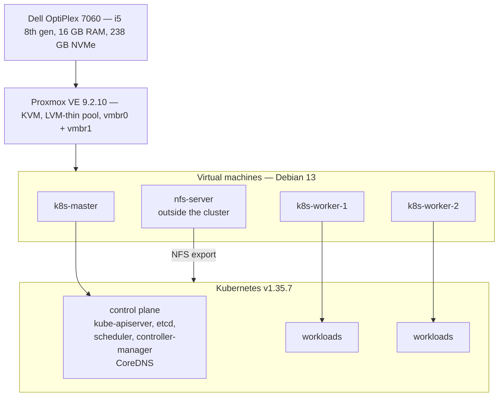
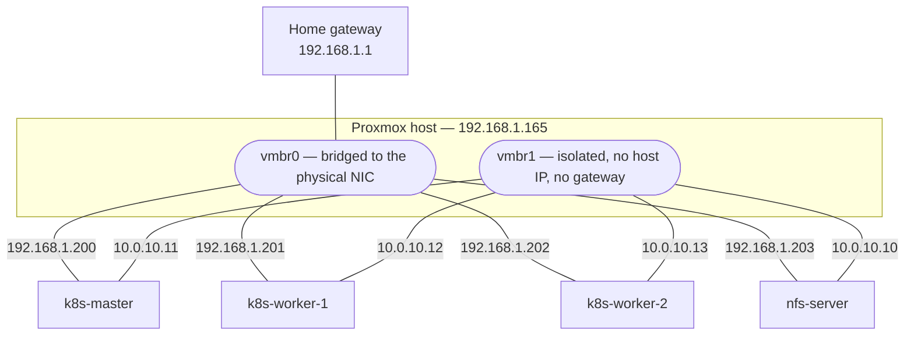
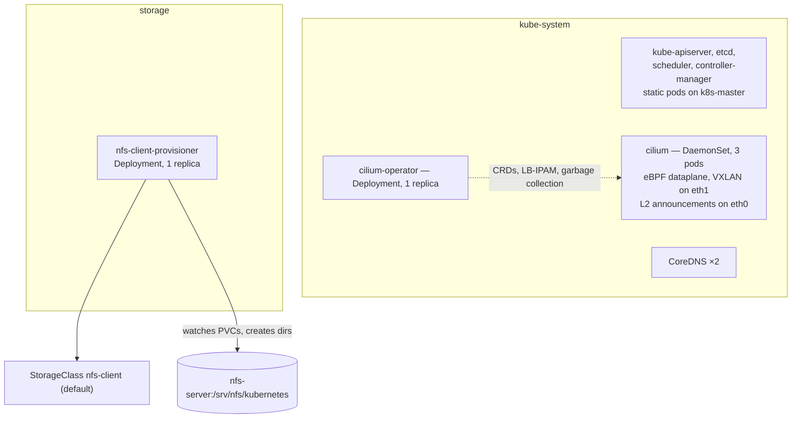

# Architecture

This document describes what the system is made of. It does not argue for the
choices — that belongs in the [decision records](decisions/), one file per
decision — and it does not describe how the system is built, which is
[provisioning.md](provisioning.md).

**State of the system.** This describes the cluster as of the rebuild on Cilium;
the run that produced it is the one in [provisioning.md](provisioning.md). Three
nodes are `Ready` on Kubernetes v1.35.7, Cilium carries the pod network and hands
out `LoadBalancer` addresses on the LAN, and a default `StorageClass` backed by
NFS provisions volumes on demand. The one thing marked *planned* is
observability.

## Layers

**Hardware.** One machine, no redundancy anywhere. The loss of the SSD, the
motherboard or the power supply is the loss of everything on it.

**Proxmox VE.** The hypervisor runs the virtual machines under KVM and owns two
pieces of state the layers above depend on: the storage pools and the network
bridges. Storage is split between `local`, a plain directory holding the cloud
image, the cloud-init snippets and backups, and `local-lvm`, an LVM-thin pool
holding the virtual disks. *LVM-thin* means volumes are thin-provisioned: a 32 GB
disk consumes only the blocks actually written. The sum of the declared sizes may
therefore exceed the pool, and does here. The failure mode that follows is worth
stating plainly — if the pool fills up, every virtual machine on it flips to
read-only at the same moment.

**Virtual machines.** Four Debian 13 machines, each with two virtual NICs. They
are the boundary between what Terraform owns and what Ansible owns: Terraform
creates them and gives them an identity and addresses, and stops there.

**Kubernetes.** Three of the four machines form the cluster, installed with
`kubeadm` on `containerd` 1.7.24. The fourth stays outside it and serves storage
over NFS.

## The four machines

Names, identifiers and sizing come from `terraform/main.tf`, which is the source
of truth for everything in this section.

| Name | VMID | Role | vCPU | Memory | System disk | Data disk |
|---|---|---|---|---|---|---|
| `k8s-master` | 200 | control plane | 2 | 3072 MB | 20 GB | — |
| `k8s-worker-1` | 201 | worker | 2 | 3584 MB | 32 GB | — |
| `k8s-worker-2` | 202 | worker | 2 | 3584 MB | 32 GB | — |
| `nfs-server` | 203 | storage, outside the cluster | 2 | 1024 MB | 10 GB | 40 GB |

Each machine is tagged in Proxmox with its role, taken from the same map, so the
hypervisor UI shows the same grouping the Ansible inventory does.

`k8s-master` keeps the standard `node-role.kubernetes.io/control-plane:NoSchedule`
taint, so no application workload lands on it. That leaves two workers,
deliberately symmetric: neither is special, and draining either one is an
unremarkable operation.

`nfs-server` carries a second virtual disk of 40 GB, mounted by UUID on
`/srv/nfs` and exported to the cluster network. Keeping it out of Kubernetes
decouples the lifetime of the data from the lifetime of the cluster — the three
nodes can be reset, reinstalled or destroyed and recreated without putting the
data at risk. Terraform marks this machine `protection = true`, which makes
Proxmox refuse to delete it; a `terraform destroy` fails on it rather than taking
the data with it. The three Kubernetes nodes carry no such flag and are
disposable by design.

The storage machine remains a single point of failure for persistent volumes. On
one physical host that is unavoidable, and replicated storage across three VMs on
the same SSD would be redundancy in appearance only.

## Networks

Every machine has two interfaces, attached to two different Proxmox bridges. A
*bridge* on the hypervisor is a virtual switch: `vmbr0` is bridged onto the
physical NIC and therefore onto the house LAN, while `vmbr1` has no physical port
and no IP address on the host side, so it is a switch that exists only between
the VMs.

**`vmbr0` — LAN, `192.168.1.0/24`.** Administration: SSH, Ansible, and `kubectl`
from the workstation. The default gateway, `192.168.1.1`, is configured on this
interface and on this interface only.

**`vmbr1` — cluster-internal, `10.0.10.0/24`.** All infrastructure traffic: etcd,
the API server, kubelet registration, the Cilium VXLAN overlay, and NFS. It has
**no gateway and no default route** — two default routes on one machine produce
intermittent failures that are unpleasant to diagnose. The hypervisor itself
holds no address on this segment.

The API server listens on `10.0.10.11:6443` and nowhere else. Nothing on the LAN
can reach it, which is the point of the second interface. `kubectl` from the
workstation therefore goes through SSH to the master; the certificate does carry
the LAN address as a SAN, so exposing it later needs no reissue.

The separation is a property of the configuration, not of the wiring — see
[provisioning.md](provisioning.md#which-interface-twice) for the three settings
that enforce it and the identical failure they produce when wrong.

`/etc/hosts` on every machine maps the four internal addresses to
`<name>.internal`, so the nodes can address each other by name over `vmbr1`
without a DNS server.

### Address plan

LAN, `192.168.1.0/24`:

| Address | Assignment |
|---|---|
| `192.168.1.1` | Gateway |
| `192.168.1.165` | Proxmox host |
| `192.168.1.200` | `k8s-master` |
| `192.168.1.201` | `k8s-worker-1` |
| `192.168.1.202` | `k8s-worker-2` |
| `192.168.1.203` | `nfs-server` |
| `192.168.1.204` – `.209` | Reserved for future nodes |
| `192.168.1.210` – `.220` | Reserved, unused — see below |

Cluster-internal, `10.0.10.0/24`:

| Address | Assignment |
|---|---|
| `10.0.10.10` | `nfs-server` |
| `10.0.10.11` | `k8s-master` |
| `10.0.10.12` | `k8s-worker-1` |
| `10.0.10.13` | `k8s-worker-2` |

Kubernetes internal ranges: pods on `10.244.0.0/16`, services on `10.96.0.0/12`.
Neither overlaps `192.168.1.0/24` or `10.0.10.0/24`.

**`LoadBalancer` addresses come from `192.168.1.210`–`.220`**, allocated by
Cilium's LB-IPAM and announced on `eth0` by ARP. The range lives inside the LAN
subnet, because a client on `192.168.1.0/24` must be able to reach it without a
route, and outside the DHCP range, because nothing else may claim an address
Cilium has handed out.

One node answers ARP for a given service address at a time. That is failover, not
load balancing: if the announcing node goes down another takes the lease, but
traffic is never spread across nodes.

The cluster is not exposed to the Internet. Access is over the LAN, from the
workstation or from another device in the house.

## Inside the cluster

**Control plane.** Single node, so `etcd` is a single member and losing the master
is losing the cluster. `controlPlaneEndpoint` is nonetheless set, because it is
what the workers are handed as the address to talk to and adding a second control
plane later requires it to have been there from the start.

**Cilium 1.20.1**, installed from its Helm chart, VXLAN backend, with IPAM in
`kubernetes` mode: `kube-controller-manager` allocates each node a `/24` out of
`10.244.0.0/16` and writes it to `Node.spec.podCIDR`; Cilium reads it and hands
addresses out of it. Address allocation therefore stays a Kubernetes concern, and
`cilium-operator` is left with the CRDs, LB-IPAM and garbage collection. The
tunnel follows the kubelet's `node-ip`, which is the internal address, so overlay
traffic never touches the LAN.

**There is no kube-proxy.** The `addon/kube-proxy` phase is skipped at
`kubeadm init` and Cilium's eBPF dataplane owns service routing — a prerequisite
for the L2 announcements above, not a performance choice. Services are inspected
with `cilium service list` rather than `iptables -t nat -L`.

The two `CiliumLoadBalancerIPPool` and `CiliumL2AnnouncementPolicy` objects are
the only Cilium configuration kept as a manifest; everything else is Helm values.

**Persistent storage** is `nfs-subdir-external-provisioner`, one replica in the
`storage` namespace, backing the default `StorageClass` `nfs-client`
(`Delete` / `Immediate` / `archiveOnDelete: true`). A claim becomes a
subdirectory of the export within seconds.

Two consequences of using the in-tree NFS volume plugin are worth stating. The
mount is performed by the *kernel of the node running the pod*, not by the pod —
which is why every node carries `nfs-common`, and why the provisioner can be
deleted without any existing pod losing its disk; it is only needed to create and
remove directories. And because the volume is `ReadWriteMany` on a share reachable
from every node, a pod rescheduled onto another worker finds exactly the same
data.

The export is served with `no_root_squash`: root on any machine in
`10.0.10.0/24` is root on the data. That is acceptable only because the segment
is isolated and has no gateway, and it is the single strongest reason not to give
`vmbr1` one.

**Certificates expire on 17 August 2027** — kubeadm's one-year default for leaf
certificates, ten years for the CAs. Nothing in the build renews them.

**Observability is deliberately absent.** See the memory budget below.

## Sizing

### Disk — the `local-lvm` thin pool

The pool holds roughly 141 GB.

| Machine | System | Data |
|---|---|---|
| `k8s-master` | 20 GB | — |
| `k8s-worker-1` | 32 GB | — |
| `k8s-worker-2` | 32 GB | — |
| `nfs-server` | 10 GB | 40 GB |
| **Declared total** | **134 GB** | headroom ≈ 7 GB |

Thin provisioning means real occupancy starts around 15–20 GB and grows with use.
The declared total is what the pool would owe if every block were written, which
is the number that matters for the read-only failure described above. Monitoring
occupancy of the pool is therefore not optional.

The separate `local` directory storage, around 60 GB free, holds the cloud image,
the cloud-init snippets and `vzdump` backups.

### Memory — 16 GB physical, about 15 GB usable

| Consumer | Allocated | Balloon minimum |
|---|---|---|
| Proxmox host | ~2 GB | — |
| `k8s-master` | 3 GB | 2 GB |
| `k8s-worker-1` | 3.5 GB | 2.5 GB |
| `k8s-worker-2` | 3.5 GB | 2.5 GB |
| `nfs-server` | 1 GB | 0.5 GB |
| **Total** | **~13 GB** | headroom ≈ 2 GB |

Terraform sets both a `dedicated` and a `floating` value per machine; the second
enables ballooning, letting the hypervisor reclaim memory a guest is not using.
Ballooning redistributes idle memory with a reaction delay — it does not create
any. Under simultaneous pressure from all four machines it saves nothing, so the
2 GB margin is a real physical reserve rather than an accounting device.

This is why an observability stack is not part of the build: Prometheus, Grafana
and Loki together consume enough to eat that margin whole. They are planned as a
later phase, one component at a time with explicit resource limits.

It is also why `nfs-subdir-external-provisioner` was chosen over the actively
maintained `csi-driver-nfs`: the latter is a controller plus a DaemonSet plus five
sidecars, on workers with 3.5 GB.

CPU is overcommitted without reservation: 8 vCPU declared across four machines on
a 4-core host. For homelab workloads this is unremarkable.

## Related documents

- [../README.md](../README.md) — overview, status, getting started.
- [provisioning.md](provisioning.md) — how the system is built, layer by layer.
- [decisions/](decisions/) — the reasoning behind the choices described here.
