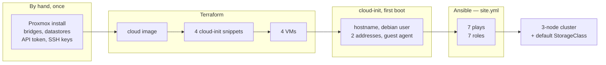
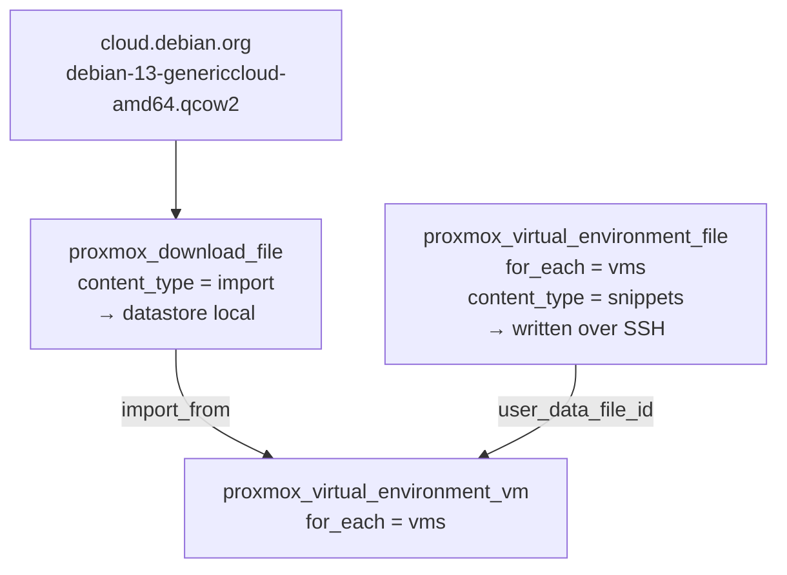
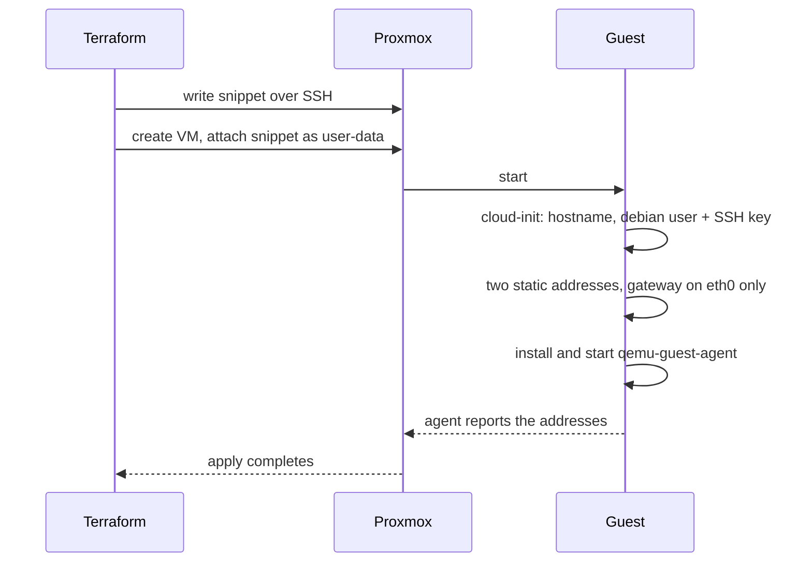
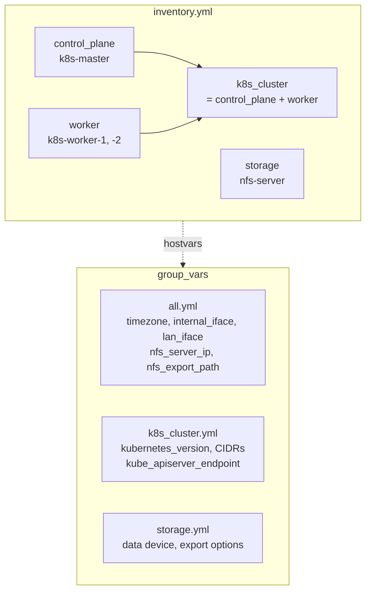
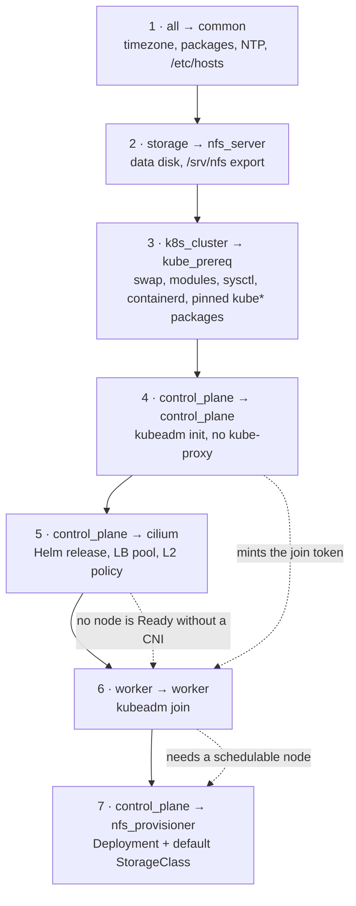
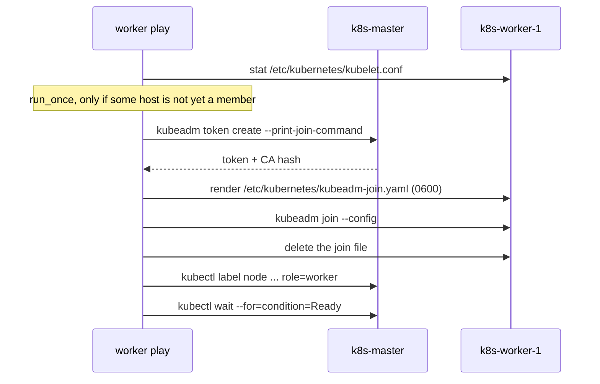
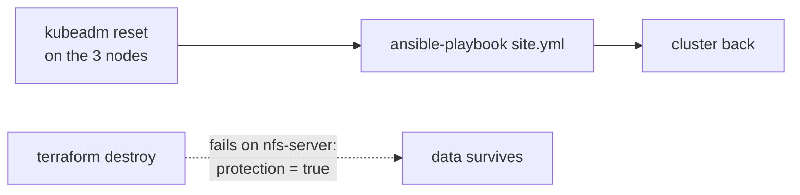

# Provisioning

How four empty virtual machines become a Kubernetes cluster with persistent storage.
[architecture.md](architecture.md) describes the system; this document describes the
build process and its order.

Terraform creates the VMs and makes them reachable by SSH. Ansible configures the
machines and the cluster. Terraform does not install packages, and Ansible does not
create VMs.



The process is idempotent. `terraform apply` on an existing set of VMs changes
nothing, and `ansible-playbook site.yml` on a running cluster reports `changed=0`.
This makes the Kubernetes nodes safe to rebuild.

## What is not automated

Four things have to exist before Terraform can run, and none of them are in this
repository:

| Prerequisite | Why it stays manual |
|---|---|
| Proxmox VE installed, `vmbr0` and `vmbr1` created | Bootstrapping the hypervisor from the hypervisor is a chicken-and-egg problem |
| `terraform@pve` user with an API token | Creating the credential the provider authenticates with |
| A `terraform` system account on the host, SSH key only | Proxmox has **no API** for uploading cloud-init snippets, so the provider writes them over SSH |
| `local` datastore accepting the **Snippets** and **Import** content types | A checkbox in the web UI; without it both the snippet upload and the image download fail with storage errors that never mention it |

Use two separate keypairs: `~/.ssh/pve-terraform` for the hypervisor account
(PEM-formatted RSA; the provider ignores `~/.ssh/config`) and `~/.ssh/homelab` for
the guest VMs.

The hypervisor's `terraform` account has **no passwordless sudo**, and that
restriction is intentional. It only needs to write files into the snippets
directory.

## Terraform

`terraform/main.tf` drives `bpg/proxmox`, pinned to an exact version in
`versions.tf` and locked with its checksums in `.terraform.lock.hcl`. The
provider is pre-1.0 and renames resource attributes between minor releases, so
neither the pin nor the committed lockfile is optional.

Everything the four machines differ by lives in one `locals.vms` map — role,
VMID, cores, memory, disk sizes, and the two addresses. Three resources consume
it:



**The image is a cloud image, not an installer ISO.** It is a pre-installed disk
image containing cloud-init, which reads its configuration at first boot instead
of asking questions on a console. An ISO could not be used here at all: there
would be no way to hand it any configuration.

**There is no template and no clone step.** Each VM's disk is created with
`import_from` pointing straight at the downloaded image. Building a golden image
with Packer, so Terraform only clones it, is a plausible next step and would
remove the need for SSH access to the hypervisor entirely.

**`protection = true` on the storage machine only**, derived from
`each.value.role == "storage"`. Proxmox then refuses to delete it, so a
`terraform destroy` fails on that machine rather than taking the data with it.
The three Kubernetes nodes carry no such flag and are disposable by design.

Disks use `virtio` with `iothread` and `discard = on`, so deletions inside the
guest are returned to the LVM-thin pool. The second disk exists only where
`data_disk_gb > 0`, through a `dynamic "disk"` block.

### First boot



The guest agent matters more than it looks: it is how Proxmox — and therefore
Terraform — learns that a machine has finished booting and which addresses it
ended up with. Without it, `apply` waits and then times out.

The gateway is set on the LAN interface only. Two default routes on one machine
produce intermittent failures that are unpleasant to diagnose.

## Ansible

Run Ansible from a Linux control machine.

### The inventory is static

`inventory.yml` is written by hand and is not generated from Terraform state. The
addresses are also declared in `terraform/main.tf`; `checks.yml` asserts that the
inventory matches the addresses reported by the machines.



Two variables in `all.yml` are derived from inventory data. `nfs_server_ip` comes from
`hostvars[groups['storage'][0]].internal_ip`, and `kube_apiserver_endpoint` from
the control-plane host. This keeps the server and mount addresses consistent.

### The seven plays

Collections first — the run fails at parse time without them:

```bash
ansible-galaxy collection install -r requirements.yml
```

```bash
ansible-playbook site.yml
```



The following explains two ordering dependencies.

**Play 6 depends on play 4 for a value, not just for a state.** Other
cross-host values in this project are written down in `inventory.yml` and merely
read. A bootstrap token is different: it is minted by the control plane, it expires,
and it is a secret. It has to travel between hosts during the run.



The token task is `run_once` with `delegate_to` on the master, and its condition
is written over `ansible_play_hosts` rather than over the current host: `run_once`
evaluates the condition on the first host of the play only, so testing the
current host alone would skip the task and leave a second worker without a
token. For the same reason the play must not be given `serial` — batching the
hosts would hide them from that decision.

A configuration file is used rather than the printed join command, because the
join also has to set `node-ip`, and `kubeadm join` accepts that only through
`--config`.

**Play 7 runs on the master but belongs after the workers.** The role only
applies API objects, so it runs where the kubeconfig is. But the provisioner is a
`Deployment`, and until a worker has joined, the only node in the cluster carries
the `node-role.kubernetes.io/control-plane:NoSchedule` taint. Merged into play 4,
it would wait out its rollout timeout on a pod with nowhere to run.

### Idempotence

**Guard on the artefact, not on a flag.** `kubeadm init` and `kubeadm join`
refuse to run twice and are not idempotent, so both are gated on a `stat` of the
file kubeadm writes *last* — `admin.conf` for the control plane, `kubelet.conf`
for a worker. Their presence indicates that the previous command completed.

**Write the final content, do not fetch and patch it.** The control plane ends by
installing `admin.conf` on the control station, with its `server:` address rewritten
from the internal network address to the LAN address, which is in the certificate
SANs. The file is read with `slurp` and written
with `copy`, rather than `fetch`ed and then edited. A fetched file would differ from
the remote one the moment it is patched, and `fetch` would re-download it on every
run.

That copy lands on `~/.kube/config` and **overwrites it**. `backup: true` keeps the
previous version. For multiple clusters, use separate files or `KUBECONFIG` with
multiple paths.

**Read the output of `kubectl apply`.** It is idempotent by design and can run
every time; it is the reporting that needs help, since it always exits 0. The
tasks set `changed_when` on the presence of `created` or `configured` in stdout —
objects that did not move come back as `unchanged`.

**Let Helm report its own changes.** `kubernetes.core.helm` compares the values
it is given against the installed release, so the `cilium` role needs no
`changed_when` of its own. This is the one component that does not follow the
`kubectl apply` pattern above; [ADR-0003](decisions/0003-helm-as-the-deployment-channel.md)
records why.

That comparison is only reliable with the `helm diff` plugin installed. The
module's own words: the default idempotency check *"can fail to report changes
when `release_state` is set to `present` and `chart_repo_url` is defined"* — both
of which this role does. The plugin is therefore installed by the role, before
the release, and the `changed=0` claim at the top of `site.yml` depends on it.

**Wait for the CRDs, not for the operator.** `CiliumLoadBalancerIPPool` and
`CiliumL2AnnouncementPolicy` are registered by the operator at runtime; the chart
does not carry them. Applying the pool immediately after the release fails with
`no matches for kind`, so the role interposes a `kubectl wait --for=condition=established`,
itself retried because `kubectl wait` errors on a resource that does not exist
yet instead of waiting for it.

### Which interface, twice

A second NIC separates nothing on its own. Three components have to be told
explicitly which address to use, and all three fail silently when wrong — the
cluster comes up, reports `Ready`, and quietly routes everything over the LAN:

| Component | Where |
|---|---|
| kube-apiserver | `localAPIEndpoint.advertiseAddress` in the kubeadm config |
| kubelet | `nodeRegistration.kubeletExtraArgs` `node-ip`, in **both** the init and the join configs |
| Cilium | `devices` in the Helm values; the VXLAN tunnel follows the kubelet `node-ip`, and `eth0` is listed only so L2 announcements can leave on the LAN |

### `any_errors_fatal`

Ansible's default is to drop a failed host and carry on with the others. That is
right for a fleet of web servers and wrong for a cluster, so three plays override
it:

- **play 2**, because it sits early *only* to fail fast on a missing data disk;
- **play 3**, because a half-prepared node still joins and still reports `Ready`,
  and only fails when something is scheduled on it;
- **play 4**, because every play below delegates to that host, and their failures
  would be reported somewhere else entirely;
- **play 5**, because a cluster without a CNI has no `Ready` node and nothing
  below it can succeed.

Play 6 keeps the default on purpose: one worker out of two is a degraded cluster,
not a failed build, and play 7 still has somewhere to schedule.

### Tags

Every play carries a tag. Tags **replay** one layer on a live
cluster — not to install with. `--tags kube_prereq` on a bare set of VMs skips
everything the join depends on and fails. The whole file is the installation
procedure.

`--tags cilium` requires particular care. It replays the Helm release on a
cluster that already runs Cilium, which is fine; it is *not* a way to change the
CNI of a running cluster. That operation needs a second pod CIDR, `cluster-pool`
IPAM and a node-by-node rollout — a procedure, not a tag. The way this repository
changes CNI is `terraform destroy` followed by a rebuild.

`storage` spans two plays, `nfs_server` and `nfs_provisioner`: the two ends of
the same contract.

## Verification

`checks.yml` is **not** imported by `site.yml`. It changes nothing and can be run
before or after provisioning, including on fresh VMs.

```bash
ansible-playbook checks.yml
```

It asserts that the LAN address Ansible connected to is the declared one, that
`eth1` exists and carries the declared `internal_ip`, that the NFS server and the
API endpoint answer a ping *pinned to `eth1`* (the default route goes through
`eth0`, so this proves the second interface itself works), that the clock is
within five seconds of the control node, that passwordless sudo works, and that
the storage node's data device is either blank or already carries the expected
filesystem.

Every assertion in it holds both before and after the roles run. Anything that
only becomes true once a role has done its job belongs to that role.

## Rebuilding

The three Kubernetes nodes are disposable; the data is not.



Destroying the machines themselves is a `terraform destroy` restricted to the
three nodes, since the storage VM refuses to be deleted:

```bash
terraform destroy -target='proxmox_virtual_environment_vm.debian_vms["k8s-master"]' -target='proxmox_virtual_environment_vm.debian_vms["k8s-worker-1"]' -target='proxmox_virtual_environment_vm.debian_vms["k8s-worker-2"]'
```

The recreated machines generate new SSH host keys, and `accept-new` does not
cover a key that changed — that case is indistinguishable from an impersonation.
The old entries have to go before Ansible can connect again:

```bash
for ip in 192.168.1.200 192.168.1.201 192.168.1.202; do ssh-keygen -R "$ip"; done
```

Resetting the cluster and re-running `site.yml` rebuilds it from the same pinned
versions. The persistent volumes are directories on an NFS export that Kubernetes
never owned, so they are still there afterwards — a claim recreated with the same
name will not find them automatically, but nothing was destroyed.

Deleting a `PersistentVolumeClaim` renames its directory to `archived-<name>`
instead of removing it (`archiveOnDelete: "true"`). This preserves data after an
accidental deletion but consumes disk space.

## Maintenance the build does not cover

- **The certificates expire on 17 August 2027.** kubeadm issues one-year
  certificates by default; the CAs are good for ten. `kubeadm certs renew all`
  followed by a restart of the control plane pods, before that date.
- **Kubernetes upgrades are deliberately blocked.** `kubelet`, `kubeadm` and
  `kubectl` are held at `1.35.7-1.1` via `dpkg_selections`, because
  `unattended-upgrades` is active on these images and would otherwise move one
  node to another minor version, at night, silently. Upgrading means changing
  `kubernetes_version` and `kubernetes_package_version` in
  `group_vars/k8s_cluster.yml` and following the kubeadm upgrade procedure — not
  re-running `site.yml`.
- **The LVM-thin pool has to be watched.** If it fills, every VM on it flips to
  read-only at the same moment.

## Related documents

- [../README.md](../README.md) — overview, status, getting started.
- [architecture.md](architecture.md) — machines, networks, addresses, sizing.
- [decisions/](decisions/) — why the choices above were made.
